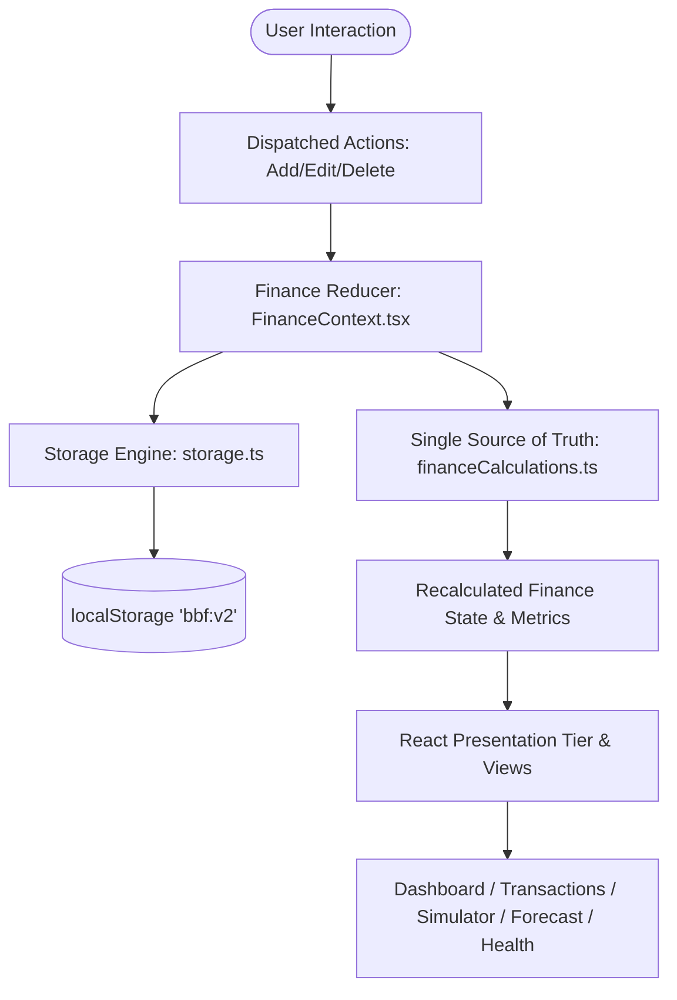

# Broke But Functional: Survive the Month 💸

> **"30 days. ₹10,000. Make every rupee count."**  
> A high-impact financial survival engine and decision sandbox built for Indian students and Gen Z managing a tight monthly budget.

[](<>)
[-blue.svg)](<>)
[-success.svg)](<>)
[-indigo.svg)](<>)
[](./LICENSE)

**🌐 Live Demo:** [https://gopalshinde01.github.io/broke-but-functional-/](https://gopalshinde01.github.io/broke-but-functional-/)  
**💻 Source Repository:** [https://github.com/gopalshinde01/broke-but-functional-](https://github.com/gopalshinde01/broke-but-functional-)

---

## 🎯 Executive Overview & Problem Statement

### The Problem
Most budgeting and personal finance applications are strictly **reactive expense logs** designed for salaried professionals with predictable cashflows. For college students and Gen Z managing an unyielding ₹10,000 monthly allowance over 30 days, retrospective accounting is already too late: spending ₹2,000 in Week 1 silently triggers catastrophic month-end deficits.

### The Solution: "Broke But Functional"
**Broke But Functional** goes far beyond basic expense tracking into an **active financial consequence simulator**:
1. **Paced Daily Spending Allowance**: Dynamically computes `(Available Spending Money) / (Days Remaining)`, safeguarding locked emergency reserves (₹1,500) and upcoming committed subscriptions.
2. **What-If Decision Simulator**: Allows students to test purchases before spending a single rupee across 3 scenarios (**Buy Now**, **Wait 7 Days**, **Skip Purchase**), showing before-and-after impacts on balance, allowance, risk, health score, and Day 30 forecast.
3. **Emergency Shock Hub**: Simulates unbudgeted emergency expenses (Medical ₹1,500, Laptop Repair ₹3,000, Travel ₹800) and quantifies their exact impact on runway.
4. **Subscription Manager**: Tracks monthly & yearly recurring commitments, calculates monthly-equivalent drag, records next due dates, and protects funds without double-counting.
5. **Multiple Savings Goals**: Enables goal creation, target tracking, and transfers without double-counting.
6. **Additional Income Ledger**: Records tutoring, stipends, and freelance inflows directly into the accounting model.
7. **Transparent 30-Day Forecast & 100-Point Health Diagnostic**: Dedicated full-screen views with explainable deterministic models.

All currency is strictly formatted in Indian Rupees (**INR / ₹**) using `Intl.NumberFormat('en-IN')`. Everything executes client-side with zero backend dependencies, zero paid third-party APIs, and versioned `localStorage` recovery.

---

## 🧭 Complete Financial Requirements & Feature Mapping

| # | Feature Area | Implementation Modules | Technical Highlights & Discoverability |
|---|---|---|---|
| **A** | **Financial Dashboard** | [`BudgetCards.tsx`](file:///c:/Users/Gopal%20shinde/Music/PROJECTS/fronted%20arena%2011-oct/src/components/dashboard/BudgetCards.tsx), [`SpendingChart.tsx`](file:///c:/Users/Gopal%20shinde/Music/PROJECTS/fronted%20arena%2011-oct/src/components/dashboard/SpendingChart.tsx) | Displays all 10 required financial metrics: Starting budget (₹10,000 / 30d), Total Additional Income, Actual Expenses, Remaining Balance, Upcoming Committed, Daily Allowance, Savings Progress, Financial Risk, Health Score, and Predicted Day 30 Balance. Demo data seeded on first launch. |
| **B** | **Expense Tracker & Income Ledger** | [`ExpenseTracker.tsx`](file:///c:/Users/Gopal%20shinde/Music/PROJECTS/fronted%20arena%2011-oct/src/components/transactions/ExpenseTracker.tsx), [`ExpenseForm.tsx`](file:///c:/Users/Gopal%20shinde/Music/PROJECTS/fronted%20arena%2011-oct/src/components/transactions/ExpenseForm.tsx), [`ExpenseList.tsx`](file:///c:/Users/Gopal%20shinde/Music/PROJECTS/fronted%20arena%2011-oct/src/components/transactions/ExpenseList.tsx) | Full CRUD: Add, Edit, Delete expenses with Name, Amount, Day/Date, Description, and Category (`Food`, `Travel`, `Shopping`, `Entertainment`, `Bills`, `Education`, `Health`, `Subscriptions`, `Emergency`, `Other`). Category breakdown summary cards with percentage bars. Dual-ledger tab to record Additional Income inflows with 5-second undo toast. |
| **C** | **Daily Spending Allowance** | [`BudgetCards.tsx`](file:///c:/Users/Gopal%20shinde/Music/PROJECTS/fronted%20arena%2011-oct/src/components/dashboard/BudgetCards.tsx), [`financeCalculations.ts`](file:///c:/Users/Gopal%20shinde/Music/PROJECTS/fronted%20arena%2011-oct/src/utils/financeCalculations.ts) | Dynamic formula: `Available Spending Money / Days Remaining`. Accounts for committed upcoming bills and protected reserves. Clamped against divide-by-zero. Meaningful warnings on low/negative allowance. |
| **D** | **Savings Goals Tracker** | [`SavingsGoals.tsx`](file:///c:/Users/Gopal%20shinde/Music/PROJECTS/fronted%20arena%2011-oct/src/components/savings/SavingsGoals.tsx) | Multi-goal tracker: goal name, target amount, current saved, progress percentage bar, contribution logging. Contributions treated as internal savings transfers to avoid double-counting. |
| **E** | **Subscription Manager** | [`SubscriptionManager.tsx`](file:///c:/Users/Gopal%20shinde/Music/PROJECTS/fronted%20arena%2011-oct/src/components/subscriptions/SubscriptionManager.tsx), [`SubscriptionItem.tsx`](file:///c:/Users/Gopal%20shinde/Music/PROJECTS/fronted%20arena%2011-oct/src/components/subscriptions/SubscriptionItem.tsx) | Supports monthly and yearly subscriptions. Converts annual fees into monthly-equivalent costs (`Math.round(amt / 12)`). Tracks next payment date (e.g. Day 25) and active vs cancelled states. Auto-reserves future commitments without duplicate subtraction. |
| **F** | **Unexpected Expense Simulator** | [`EmergencySimulator.tsx`](file:///c:/Users/Gopal%20shinde/Music/PROJECTS/fronted%20arena%2011-oct/src/components/emergency/EmergencySimulator.tsx) | Stress-tests unbudgeted shocks (Medical ₹1,500, Laptop Repair ₹3,000, Travel ₹800). Displays live impact on remaining balance, daily allowance, reserve buffer, and health score with a clear "Confirm Expense" button. |
| **G** | **What-If Decision Simulator** | [`WhatIfSimulator.tsx`](file:///c:/Users/Gopal%20shinde/Music/PROJECTS/fronted%20arena%2011-oct/src/components/simulator/WhatIfSimulator.tsx), [`SimulatorInputs.tsx`](file:///c:/Users/Gopal%20shinde/Music/PROJECTS/fronted%20arena%2011-oct/src/components/simulator/SimulatorInputs.tsx) | Sandboxes prospective purchases with description, amount, category, **Essential Need vs Non-Essential Want classification**, and planned purchase date. Evaluates 3 scenarios: **1. Buy Now**, **2. Wait 7 Days**, **3. Skip Purchase**. Simulated items never modify real financial state until explicitly confirmed. |
| **H** | **Monthly Financial Forecast** | [`FinancialForecastScreen.tsx`](file:///c:/Users/Gopal%20shinde/Music/PROJECTS/fronted%20arena%2011-oct/src/components/forecast/FinancialForecastScreen.tsx) | Dedicated full-screen 30-day forecast view. Interactive Recharts curve with actuals up to Day N and deterministic dashed projection to Day 30. Day-by-day trajectory table and explainable formula breakdown. |
| **I** | **Financial Risk Indicator** | [`BudgetCards.tsx`](file:///c:/Users/Gopal%20shinde/Music/PROJECTS/fronted%20arena%2011-oct/src/components/dashboard/BudgetCards.tsx), [`FinancialHealthScreen.tsx`](file:///c:/Users/Gopal%20shinde/Music/PROJECTS/fronted%20arena%2011-oct/src/components/health/FinancialHealthScreen.tsx) | Transparent 3-tier risk indicator (`Low`, `Medium`, `High`) based on projected Day 30 deficit, daily allowance tightness (<₹150/d), and emergency reserve preservation. Displays detailed explanatory rationale. |
| **J** | **Financial Health Score** | [`FinancialHealthScreen.tsx`](file:///c:/Users/Gopal%20shinde/Music/PROJECTS/fronted%20arena%2011-oct/src/components/health/FinancialHealthScreen.tsx), [`FinancialHealth.tsx`](file:///c:/Users/Gopal%20shinde/Music/PROJECTS/fronted%20arena%2011-oct/src/components/dashboard/FinancialHealth.tsx) | Explainable 0–100 score across 5 weighted pillars: Budget Adherence (30 pts), Month-End Outlook (25 pts), Reserve Buffer (20 pts), Savings Progress (15 pts), and Subscription Cap (10 pts). Labeled as an application budgeting indicator. |
| **K** | **Smart Financial Insights** | [`SmartInsights.tsx`](file:///c:/Users/Gopal%20shinde/Music/PROJECTS/fronted%20arena%2011-oct/src/components/insights/SmartInsights.tsx) | Dynamic recommendations generated from live ledger state: spending pace alerts, subscription burden warnings, reserve deficit flags, and savings milestone cheer. |

---

## 🏛️ System Architecture

The application enforces a decoupled, layered software architecture with single-responsibility modularization:

```
src/
├── types/                     # Zero-any strict TypeScript type definitions & unions
│   └── index.ts               # Expense, IncomeItem, Subscription, SavingsGoal, CalculationResult
├── constants/                 # Centralized configuration & static presets
│   └── index.ts               # Scoring weights, risk thresholds, categories, demo seed data
├── utils/                     # Pure mathematical and storage logic (framework agnostic)
│   ├── financeCalculations.ts # Single source of truth financial engine & Monte Carlo simulation
│   ├── storage.ts             # Versioned schema validation, corruption recovery, CSV/JSON I/O
│   └── __tests__/             # Vitest pure calculation and storage unit test suites
├── context/                   # State management & action dispatching
│   ├── FinanceContext.tsx     # Centralized React Context and persistent reducer
│   └── __tests__/             # Reducer state transition tests
├── hooks/                     # Custom React hooks
│   ├── useFinance.ts          # Facade hook combining finance context and simulation state
│   ├── useSimulation.ts       # Isolated sandbox simulation hook
│   └── useLocalStorage.ts     # Resilient localStorage hook
├── components/                # Presentation tier (split by functional domain)
│   ├── ui/                    # Reusable UI kit (Button, Card, Modal, ProgressBar, Toast)
│   ├── layout/                # Responsive SidebarNav and DashboardHeader
│   ├── dashboard/             # BudgetCards (10 metrics), SpendingChart, WhatIfSliderCard
│   ├── transactions/          # ExpenseTracker, ExpenseList (with Edit), ExpenseForm, IncomeList
│   ├── simulator/             # WhatIfSimulator, SimulatorInputs (Need vs Want), DecisionMatrixTable
│   ├── emergency/             # EmergencySimulator (Shock testing hub)
│   ├── savings/               # SavingsGoals tracker & milestone progress
│   ├── subscriptions/         # SubscriptionManager (Monthly/Yearly frequencies & dates)
│   ├── forecast/              # FinancialForecastScreen (Dedicated 30-day forecast view)
│   ├── health/                # FinancialHealthScreen (Dedicated 100-pt diagnostic view)
│   └── insights/              # SmartInsights & CycleSettingsForm
└── App.tsx                    # Root routing container with React.lazy code-splitting
```

### Unidirectional Data Flow



---

## 🧮 One Shared Calculation Engine & Accounting Rules

All components, cards, charts, and simulators consume a single centralized pure function: `calc(state, extra = 0)` in [`src/utils/financeCalculations.ts`](file:///c:/Users/Gopal%20shinde/Music/PROJECTS/fronted%20arena%2011-oct/src/utils/financeCalculations.ts).

### Core Accounting Equations

$$\text{Actual Balance} = \text{Starting Budget} + \sum \text{Incomes} - \sum \text{Expenses}$$

$$\text{Committed Fixed Costs} = \sum_{\text{active}} \begin{cases} \text{round}(\text{amt} / 12) & \text{if yearly} \\ \text{amt} & \text{if monthly} \end{cases}$$

$$\text{Available Spending Money} = \text{Actual Balance} - \text{Emergency Reserve} - \text{Committed Fixed Costs}$$

$$\text{Days Remaining} = \max(1, 30 - \text{Current Day})$$

$$\text{Daily Spending Allowance} = \frac{\max(0, \text{Available Spending Money})}{\text{Days Remaining}}$$

$$\text{Projected Day 30 Balance} = \text{Actual Balance} - \text{Committed Fixed Costs} - (\text{Discretionary RunRate} \times \text{Days Remaining})$$

### Accounting Invariance Guarantees
- **No Double-Counting**: Savings goal contributions recorded in the ledger are flagged (`cat: 'Savings'`) and excluded from discretionary burn-rate calculations so students are not penalized for saving.
- **Commitments Protection**: Subscriptions are deducted from `Available Spending Money` and future projections, but are **never** subtracted twice from actual balance.
- **Strict Simulation Isolation**: Simulated purchases in `WhatIfSimulator` pass an `extra` parameter to pure calculations. State mutation occurs **only** when the user clicks the explicit "Confirm Purchase" button.

---

## 🛡️ Financial Health Score & Risk Methodology

### 1. 100-Point Financial Health Scoring Model
The health score is recalculable in real time and bounded strictly in $[0, 100]$:

| Pillar | Weight | Metric Formula | Objective |
|---|---|---|---|
| **Budget Adherence** | 30 pts | $30 \times \text{clamp}\left(1 - \frac{\max(0, \text{spent} - \text{pace})}{0.25 \times \text{budget}}\right)$ | Rewards spending within the ideal ₹333/day trajectory. |
| **Reserve Buffer** | 20 pts | $20 \times \text{clamp}\left(\frac{\text{remaining} - \text{committed}}{\max(1, \text{reserve})}\right)$ | Safeguards the ₹1,500 emergency safety cushion. |
| **Month-End Outlook** | 25 pts | $25 \times \text{clamp}\left(\frac{\text{projectedDay30Balance}}{0.15 \times \text{budget}}\right)$ | Measures probability of surviving Day 30 in positive balance. |
| **Savings Progress** | 15 pts | $15 \times \text{clamp}\left(\frac{\text{totalSaved}}{\max(1, \text{totalTarget})}\right)$ | Tracks completion of user-defined savings goals. |
| **Subscription Cap** | 10 pts | $10 \times \text{clamp}\left(1 - \frac{\text{committed}}{0.20 \times \text{budget}}\right)$ | Prevents fixed auto-renewals from consuming >20% of budget. |

*Disclaimer: Application-generated budgeting indicator for educational purposes; not formal financial advice.*

### 2. Transparent Financial Risk Indicator
- **High Risk**: Triggered if daily allowance drops to $\le 0$ or predicted Day 30 balance is in deficit ($< ₹0$).
- **Medium Risk**: Triggered if daily allowance is tight ($< ₹150$/day) or predicted balance breaches the emergency reserve floor.
- **Low Risk**: Healthy runway with daily allowance $> ₹150$/day and projected balance comfortably above reserve.

---

## 🔒 Data Persistence & Storage Integrity

- **Versioned LocalStorage (`bbf:v2`)**: Automatically saves state changes with debounce.
- **Defensive Type Guards**: `isValidFinanceState`, `isValidExpense`, `isValidSubscription` inspect stored JSON before hydration.
- **Corruption Resilience**: If stored data contains corrupted JSON or invalid fields, the application falls back safely to `DEMO_MONTH_STATE` without runtime crashes.
- **Import / Export**: Full JSON and CSV export/import supported in Settings with a confirmation dialog.
- **Demo Data Preservation**: Resetting to Blank or reloading Demo data is guarded with confirmation prompts.

---

## 🧪 Automated Testing & Verification

The test suite runs with **Vitest** and **React Testing Library**:

```bash
# Run complete test suite (46 passing tests)
npm test

# Run strict TypeScript typecheck
npm run typecheck

# Run ESLint validation
npm run lint

# Run production build
npm run build
```

### Verified Test Results
```
 ✓ src/utils/__tests__/storage.test.ts (10 tests)
 ✓ src/context/__tests__/financeReducer.test.ts (11 tests)
 ✓ src/utils/__tests__/financeCalculations.test.ts (19 tests)
 ✓ src/components/__tests__/ExpenseTracker.test.tsx (4 tests)
 ✓ src/components/__tests__/Simulator.test.tsx (2 tests)

Test Files  5 passed (5)
Tests       46 passed (46)
Duration    2.72s
```

---

## 🚀 Getting Started

```bash
# 1. Clone the repository
git clone https://github.com/gopalshinde01/broke-but-functional-.git
cd broke-but-functional-

# 2. Install dependencies
npm install

# 3. Start development server
npm run dev

# 4. Build production bundle
npm run build

# 5. Preview production build locally
npm run preview
```

---

## 📄 License

Distributed under the [MIT License](./LICENSE). Built with ❤️ for students making every rupee count.
