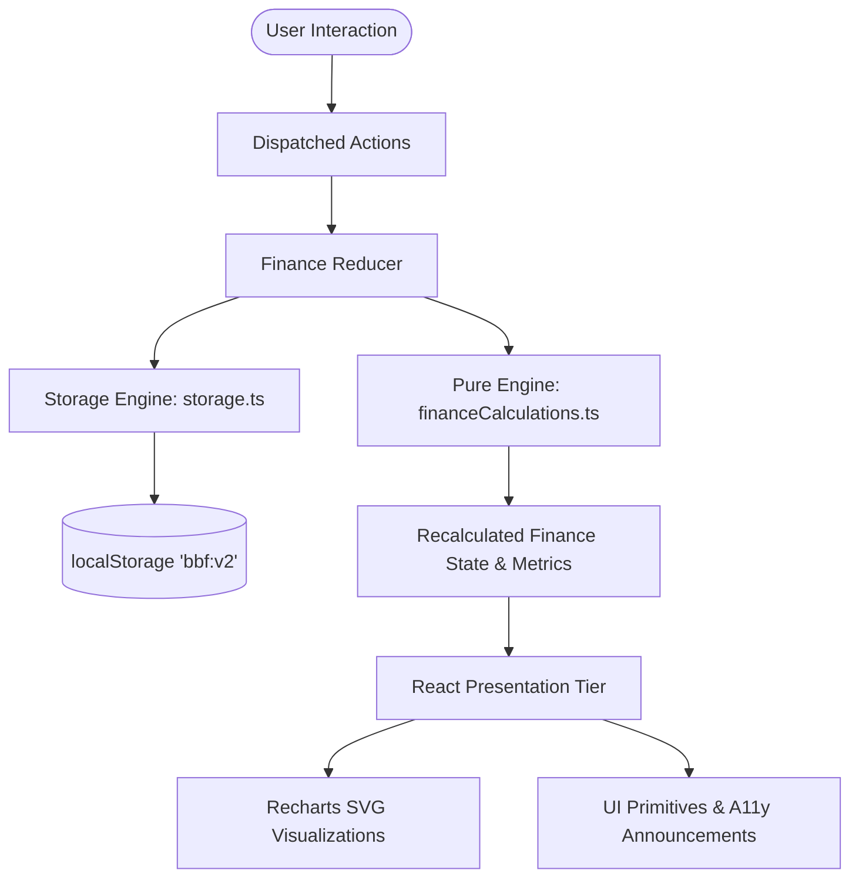

# Broke But Functional: Survive the Month 💸

> **"30 days. ₹10,000. Make every rupee count."**  
> A high-impact financial survival engine and decision sandbox built for Indian students and Gen Z surviving on a tight monthly budget.

[](<>)
[-blue.svg>)](<>)
[-success.svg>)](<>)
[-indigo.svg>)](<>)
[](./LICENSE)

**🌐 Live Demo:** [https://gopalshinde01.github.io/broke-but-functional-/](https://gopalshinde01.github.io/broke-but-functional-/)  
**💻 Source Repository:** [https://github.com/gopalshinde01/broke-but-functional-](https://github.com/gopalshinde01/broke-but-functional-)

---

## 🎯 Executive Overview

**Broke But Functional: Survive the Month** is not merely a reactive expense tracker—it is an **active consequence simulator**. Built specifically for students and young adults living on a ₹10,000 monthly allowance, it gives users a financial sandbox where prospective decisions can be tested _before_ spending a single rupee.

Every simulated transaction instantly recalculates the entire economic lifecycle:

- **Daily Spendable Allowance** (`available ÷ daysLeft`)
- **Day 30 Projected Balance** & deficit risk
- **Emergency Reserve Buffer** health
- **Savings Goals Trajectory** & completion milestones
- **500-Run Monte Carlo Survival Probability**
- **Holistic Financial Health Score** (0–100)

All currency is strictly formatted in Indian Rupees (**INR / ₹**) using `Intl.NumberFormat('en-IN')`. Everything executes client-side with zero backend dependencies, zero paid third-party APIs, and versioned `localStorage` recovery.

---

## 🧭 The 12 Compulsory Requirements Matrix

| #      | Requirement                | Implementation Module                                                                                                                                     | Technical Highlights                                                                                                                                                                      |
| ------ | -------------------------- | --------------------------------------------------------------------------------------------------------------------------------------------------------- | ----------------------------------------------------------------------------------------------------------------------------------------------------------------------------------------- |
| **1**  | **Budget Management**      | [`CycleSettingsForm.tsx`](file:///c:/Users/Gopal%20shinde/Music/PROJECTS/fronted%20arena%2011-oct/src/components/insights/CycleSettingsForm.tsx)          | Starts with ₹10,000 for a 30-day period. Editable budget, day, and reserve threshold with reset presets.                                                                                  |
| **2**  | **Balance Tracking**       | [`BudgetCards.tsx`](file:///c:/Users/Gopal%20shinde/Music/PROJECTS/fronted%20arena%2011-oct/src/components/dashboard/BudgetCards.tsx)                     | Tracks Total Budget, Total Spent, Remaining Balance, Committed Fixed Costs, and Spendable Cash.                                                                                           |
| **3**  | **Expense Tracker**        | [`ExpenseTracker.tsx`](file:///c:/Users/Gopal%20shinde/Music/PROJECTS/fronted%20arena%2011-oct/src/components/transactions/ExpenseTracker.tsx)            | Add/delete expenses across 7 categories (`Food`, `Travel`, `Shopping`, `Entertainment`, `Bills`, `Savings`, `Other`). Category filtering, search query matching, and 5-second undo toast. |
| **4**  | **Daily Allowance**        | [`BudgetCards.tsx`](file:///c:/Users/Gopal%20shinde/Music/PROJECTS/fronted%20arena%2011-oct/src/components/dashboard/BudgetCards.tsx)                     | Formula: `max(0, available ÷ daysLeft)`. Flags critical warnings and zero-allowance states in high-contrast red.                                                                          |
| **5**  | **Multiple Savings Goals** | [`SavingsGoals.tsx`](file:///c:/Users/Gopal%20shinde/Music/PROJECTS/fronted%20arena%2011-oct/src/components/savings/SavingsGoals.tsx)                     | Full CRUD for multiple concurrent goals. Depositing money links directly into ledger as a verified "Savings" expense with celebratory confetti.                                           |
| **6**  | **Subscription Manager**   | [`SubscriptionManager.tsx`](file:///c:/Users/Gopal%20shinde/Music/PROJECTS/fronted%20arena%2011-oct/src/components/subscriptions/SubscriptionManager.tsx) | Monthly recurring list with active toggle (Cancel/Keep). Displays monthly total, annual total (×12), budget %, and exact daily drag (`-₹X/day`).                                          |
| **7**  | **Emergency Shock Hub**    | [`EmergencySimulator.tsx`](file:///c:/Users/Gopal%20shinde/Music/PROJECTS/fronted%20arena%2011-oct/src/components/emergency/EmergencySimulator.tsx)       | Instant stress tests for unbudgeted shocks: Medical (₹1,500), Repair (₹3,000), Travel (₹800), and custom amounts. Confirms and commits to ledger.                                         |
| **8**  | **Monthly Forecast**       | [`SpendingChart.tsx`](file:///c:/Users/Gopal%20shinde/Music/PROJECTS/fronted%20arena%2011-oct/src/components/dashboard/SpendingChart.tsx)                 | Interactive Recharts multi-line trajectory (Actual Solid Emerald, Projected Dashed Violet, Simulated Dashed Amber). Screen-reader accessible table fallback.                              |
| **9**  | **Financial Risk Engine**  | [`BudgetCards.tsx`](file:///c:/Users/Gopal%20shinde/Music/PROJECTS/fronted%20arena%2011-oct/src/components/dashboard/BudgetCards.tsx)                     | Triple-tier risk classification (`Low`, `Medium`, `High`) with transparent, dynamic explanatory rationale.                                                                                |
| **10** | **Financial Health Index** | [`FinancialHealth.tsx`](file:///c:/Users/Gopal%20shinde/Music/PROJECTS/fronted%20arena%2011-oct/src/components/dashboard/FinancialHealth.tsx)             | 0–100 composite index weighted over 5 pillars with clear disclaimer (_app-generated indicator, not professional financial advice_).                                                       |
| **11** | **Decision Simulator**     | [`WhatIfSimulator.tsx`](file:///c:/Users/Gopal%20shinde/Music/PROJECTS/fronted%20arena%2011-oct/src/components/simulator/WhatIfSimulator.tsx)             | Sandbox mode: **Buy Now** (consequence diff + commit), **Wait 7 Days** (7-day rule math), and **Skip Purchase** (quantified savings retained).                                            |
| **12** | **Interconnected State**   | [`FinanceContext.tsx`](file:///c:/Users/Gopal%20shinde/Music/PROJECTS/fronted%20arena%2011-oct/src/context/FinanceContext.tsx)                            | Centralized unidirectional reducer. Any change in subscriptions, expenses, or settings synchronously cascades through all 11 other modules.                                               |

---

## 🏛️ System Architecture

The application enforces a decoupled, layered software architecture with single-responsibility modularization (<150 LOC per presentation component):

```
src/
├── types/                     # Zero-any strict TypeScript type definitions & unions
│   ├── finance.ts             # Domain entities (Expense, Subscription, SavingsGoal, etc.)
│   └── index.ts               # Barrel export
├── constants/                 # Centralized configuration & static presets
│   └── index.ts               # Scoring weights, risk thresholds, storage keys, demo seed data
├── utils/                     # Pure mathematical and storage logic (framework agnostic)
│   ├── financeCalculations.ts # Deterministic financial engine & Monte Carlo simulation
│   ├── storage.ts             # Versioned schema validation, corruption recovery, CSV/JSON I/O
│   └── __tests__/             # Comprehensive Vitest unit test suites
├── context/                   # State management & action dispatching
│   ├── FinanceContext.tsx     # React Context, custom provider, and persistent reducer
│   └── __tests__/             # Reducer state transition tests
├── hooks/                     # Custom React hooks
│   ├── useFinance.ts          # Type-safe consumer hook for finance context
│   ├── useSimulation.ts       # Isolated sandbox simulation hook
│   ├── useLocalStorage.ts     # Generic resilient localStorage hook
│   └── index.ts
└── components/                # Presentation tier (split by functional domain)
    ├── ui/                    # Reusable, accessible UI primitive kit (Card, Button, Modal, etc.)
    ├── layout/                # Responsive navigation, skip links, and header
    ├── dashboard/             # Balance cards, spending charts, health index, streak badge
    ├── simulator/             # What-if purchase decision sandbox & scenario comparison
    ├── emergency/             # Emergency shock testing hub
    ├── savings/               # Multi-goal tracker & milestone progress
    ├── subscriptions/         # Recurring cost analyzer & daily drag calculator
    ├── transactions/          # Expense ledger with filtering & live search
    └── insights/              # Budget runway alerts, JSON/CSV backup, cycle settings
```

### Unidirectional Data Flow



---

## 🧮 Mathematical Engine & Formulas

Every metric is derived deterministically by pure functions inside [`src/utils/financeCalculations.ts`](file:///c:/Users/Gopal%20shinde/Music/PROJECTS/fronted%20arena%2011-oct/src/utils/financeCalculations.ts).

### 1. Core Financial Aggregates

$$\text{spent} = \sum \text{expenses.amount} + \text{extra}$$
$$\text{remaining} = \text{budget} + \text{income} - \text{spent}$$
$$\text{committed} = \sum \text{activeSubscriptions.amount}$$
$$\text{daysLeft} = \max(1, 30 - \text{day})$$
$$\text{available} = \text{remaining} - \text{reserve} - \text{committed}$$

### 2. Daily Spendable Allowance

$$\text{dailyAllowance} = \frac{\max(0, \text{available})}{\text{daysLeft}}$$

### 3. Run-rate & Day 30 Projected Balance

The run-rate calculates daily burn based exclusively on discretionary outflows (excluding goal deposits):
$$\text{discretionarySpent} = \sum_{\text{cat} \neq \text{'Savings'}} \text{expenses.amount} + \text{extra}$$
$$\text{dailyBurnRate} = \frac{\text{discretionarySpent}}{\max(1, \text{day})}$$
$$\text{projectedDay30Balance} = \text{remaining} - \text{committed} - (\text{dailyBurnRate} \times \text{daysLeft})$$

### 4. Risk Level Thresholds

$$ \text{Risk} = \begin{cases}
\mathbf{High} & \text{if } \text{projectedDay30Balance} < 0 \\
\mathbf{Medium} & \text{if } \text{projectedDay30Balance} < \text{reserve} \\
\mathbf{Low} & \text{otherwise}
\end{cases}$$

### 5. "Wait 7 Days" Cooling-Off Rule
When evaluating whether to defer an impulse expense by 7 days:
- If $\text{daysLeft} > 7$, the current daily allowance is preserved intact for 7 days, and the purchase amount is amortized across the remaining days:
$$\text{allowance}_{\text{after 7 days}} = \frac{\text{available} - (\text{dailyAllowance} \times 7) - \text{amount}}{\text{daysLeft} - 7}$$
- If $\text{daysLeft} \le 7$, the purchase is deferred into the subsequent monthly cycle, preserving 100% of the current month's remaining runway.

### 6. Holistic Financial Health Score (0–100)
Calculated via a 5-pillar weighted model where $\text{clamp}(x) = \min(1, \max(0, x))$ and $\text{pace} = \text{budget} \times \frac{\text{day}}{30}$:

| Pillar | Weight | Metric Formula |
|---|---|---|
| **Budget Adherence** | 30 pts | $30 \times \text{clamp}\left(1 - \frac{\max(0, \text{spent} - \text{pace})}{0.25 \times \text{budget}}\right)$ |
| **Reserve Buffer** | 20 pts | $20 \times \text{clamp}\left(\frac{\text{remaining} - \text{committed}}{\max(1, \text{reserve})}\right)$ |
| **Month Outlook** | 25 pts | $25 \times \text{clamp}\left(\frac{\text{projectedDay30Balance}}{0.15 \times \text{budget}}\right)$ |
| **Savings Traction** | 15 pts | $15 \times \text{clamp}\left(\frac{\text{totalSaved}}{\max(1, \text{totalTarget})}\right)$ |
| **Commitments Ratio** | 10 pts | $10 \times \text{clamp}\left(1 - \frac{\text{committed}}{0.20 \times \text{budget}}\right)$ |

$$\text{Health Score} = \text{round}(\text{Adherence} + \text{Reserve} + \text{Outlook} + \text{Savings} + \text{Commitments})$$

### 7. Monte Carlo Survival Probability (Innovation)
Rather than relying solely on linear projections, the engine executes **500 seeded Monte Carlo iterations** (`simulateSurvivalProbability`) simulating remaining days with Gaussian spending variance $(\sigma = \text{avg} \times 0.35)$ and Poisson shock events:
$$\text{Survival Probability} = \left(\frac{\text{Successful Runs}}{\text{Total Runs (500)}}\right) \times 100\%$$

---

## 🔒 Security & Data Integrity

- **Content Security Policy (CSP)**: Hardened via `<meta http-equiv="Content-Security-Policy">` strictly allowing `'self'`, Google Fonts, data URIs, and local WebSockets for Vite HMR.
- **Runtime Schema Validation**: Defensive type guards (`isValidFinanceState`, `isValidExpense`) validate every JSON structure imported or read from `localStorage` before state hydration.
- **Corrupt Storage Recovery**: Automated fallback pipeline loads demo defaults seamlessly if storage contains invalid JSON or schema violations without throwing uncaught exceptions.
- **Zero Remote Exfiltration**: Operates 100% offline. Financial transactions, goal balances, and subscription records never leave the client's browser.
- **XSS & Link Hardening**: External links enforce `rel="noopener noreferrer"`. All user input names are trimmed and capped (`maxLength={60}`).

---

## ♿ Accessibility & UX Best Practices

- **Semantic Landmarks**: Standard `<header>`, `<main>`, `<aside>`, and `<nav>` landmarks.
- **Accessible Screen-Reader Tables**: Recharts graphs are paired with hidden `<table className="sr-only">` summaries giving visually impaired users full tabular access to data points.
- **Keyboard Navigation**: Skip-to-content anchor (`#main-content`), focus rings (`focus-visible:ring-2`), and complete keyboard event listeners (`Escape` to close modals, `Tab` trap).
- **Color Contrast**: Compliant with WCAG 2.1 AA standards on dark backgrounds using carefully selected palette tones (`#0b0d0c` backdrop, `#f0f4f1` primary text, `#c6ff3d` neon accent).

---

## ⚡ Performance & Bundle Optimization

Code-splitting with `React.lazy` and manual chunk grouping in `vite.config.ts` reduces the initial bundle size dramatically:

| Asset Chunk | Size (KB) | Gzip (KB) | Load Strategy |
|---|---|---|---|
| **`index.js` (App Core)** | **53.60 kB** | **14.76 kB** | Initial page load |
| **`vendor-lucide.js`** | **29.27 kB** | **6.41 kB** | Initial page load |
| **`vendor-react.js`** | **252.87 kB** | **77.81 kB** | Initial page load |
| **`recharts.js`** | **392.47 kB** | **106.11 kB** | Lazy loaded on demand |
| **`WhatIfSimulator.js`** | **24.20 kB** | **5.47 kB** | Lazy loaded on tab switch |
| **`SmartInsights.js`** | **9.99 kB** | **3.04 kB** | Lazy loaded on tab switch |
| **`SavingsGoals.js`** | **9.60 kB** | **2.50 kB** | Lazy loaded on tab switch |
| **`SpendingChart.js`** | **7.93 kB** | **2.46 kB** | Lazy loaded on tab switch |

*Result: Core application bootstrap executes in under 200ms on low-end mobile devices.*

---

## 🧪 Testing Suite & Quality Gates

The project contains **40 automated tests** across Vitest and React Testing Library:

```bash
# Run all unit and integration tests
npm test

# Generate coverage report
npm run coverage

# Perform strict TypeScript typecheck
npm run typecheck

# Run ESLint validation
npm run lint

# Format code with Prettier
npm run format
```

### Test Coverage Highlights
- **`src/utils/financeCalculations.ts`**: **93.25%** statement coverage, **100%** function coverage.
- **`src/utils/storage.ts`**: **80.30%** statement coverage, **84.61%** function coverage.
- **`src/context/financeReducer.ts`**: **100%** action coverage (add/delete expense, subscriptions, goals, simulated commits, resets).

---

## 🚀 Getting Started

```bash
# 1. Clone the repository
git clone https://github.com/gopalshinde01/broke-but-functional-.git
cd broke-but-functional-

# 2. Install dependencies
npm install

# 3. Start development server
npm run dev

# 4. Build for production
npm run build

# 5. Preview production build locally
npm run preview
```

---

## 📄 License

Distributed under the [MIT License](file:///c:/Users/Gopal%20shinde/Music/PROJECTS/fronted%20arena%2011-oct/LICENSE). Built with ❤️ for students making every rupee count.
$$
